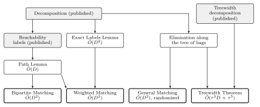
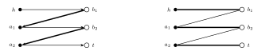

# Exact Maximum Matching in Planar Networks

Distributed algorithms that compute an exact maximum matching of a planar network in a number of rounds that depends on the diameter of the network, and only polylogarithmically on its size.

**Status: every result here is a claim.** The proofs are written, and they have been tested by simulation, partly formalized in Lean, and reviewed by independent AI referees and adversaries, none of which broke a theorem. No human expert has checked them. See [How far to trust this](#how-far-to-trust-this).

## The problem

Each vertex of a network is a small computer that knows only its own neighbours. In one round, every pair of neighbours can exchange a message of O(log n) bits. This is the CONGEST model. At the end, every vertex must know its partner in a *maximum matching*: a largest possible set of edges in which no two edges share a vertex.

The question is how many rounds this takes. Two numbers matter:

- **n**, the number of vertices;
- **D**, the hop diameter, the largest number of hops between two vertices.

Õ hides factors polylogarithmic in n. Information must cross the network, so Ω(D) rounds are needed. On general networks the exact algorithms we found depend on the size of the matching, which can be close to n. Planar networks allow more: they have small separators, and D can be far below n.

## Main results

| Problem | Rounds here | Best earlier bound we found |
|---|---|---|
| **Maximum matching, bipartite planar** | **Õ(D²)** | Õ(D⁷), implied by the treewidth bound of [arXiv:2205.14897](https://arxiv.org/abs/2205.14897) |
| Maximum weight matching, bipartite planar | Õ(D³) | none polynomial in D alone |
| Minimum vertex cover and maximum independent set, bipartite planar | Õ(D²) | Õ(D⁷), from the first row with König's theorem |
| **Maximum matching, general planar**, zero error, with the Gallai-Edmonds sets | **Õ(D²)**, randomized | Õ(s\*), where s\* is the size of a maximum matching, [arXiv:2311.04140](https://arxiv.org/abs/2311.04140) |
| Maximum matching, treewidth τ, not necessarily planar or bipartite | Õ(τ³D + τ⁵), randomized | Õ(τ⁴D + τ⁷), bipartite only, [arXiv:2205.14897](https://arxiv.org/abs/2205.14897) |

These rows use only published decompositions and labels, plus the proofs in this repository. The earlier bounds come from literature searches, which are not proof that nothing better exists.

Two bounds improve under the **Label Hypothesis**, an assumption stated in the companion repository [ExactShortestPathsAndFlowsOnPlanarGraphs](https://github.com/ssenge/ExactShortestPathsAndFlowsOnPlanarGraphs). If the hypothesis fails, only these two rows fall away, and the bounds above still stand.

| Problem | Rounds, given the Label Hypothesis | Without it |
|---|---|---|
| Maximum weight matching, bipartite planar | Õ(D²) | Õ(D³) |
| Perfect matching of a bipartite planar network, or the report that none exists; prescribed degrees | Õ(D) | Õ(D²) |

Maximum matching does not follow from the Õ(D) row, since free vertices would need a super source, which is not planar.

## How it works

Shaded boxes are published tools, and boxes with thick borders are the main theorems.

**Bipartite matching.** A recursive decomposition splits the network into bags of hop diameter Õ(D) along separators of Õ(D) vertices. Pieces are solved bottom up. Then the separator vertices are put back one at a time, as in the classical sequential method of Lipton and Tarjan. Each insertion changes the matching along at most one augmenting path, so the whole problem comes down to this: find one *simple directed path* in a planar digraph, quickly.

That is the main new tool, the **Path Lemma**: a simple directed s-t path in Õ(D) rounds. There are Õ(D) insertions per level, each at Õ(D) rounds, over O(log n) levels, which gives Õ(D²).

Here the thick edges are the matching, and the new vertex h reaches the free vertex t. Flipping the path gives the matching on the right.

**Weighted matching.** The insertion becomes a primal-dual step, with one exact shortest-path computation per insertion.

**General matching.** Augmenting paths are hard without bipartiteness, so this route is algebraic. It runs Gaussian elimination on a random Tutte matrix along the tree of bags, keeping at most Õ(D²) words per bag, and then finds mates top down. A Gallai-Edmonds check verifies the answer, so the algorithm never outputs a wrong result: it restarts on a failed check.

## All results

**Matching**

| Result | Rounds | Note |
|---|---|---|
| Maximum matching, bipartite planar | Õ(D²) | [`notes/MATCHING.md`](notes/MATCHING.md) |
| Maximum weight matching, optimal dual, minimum weight perfect matching | Õ(D³) | same note, with [`notes/EXACT_LABELS.md`](notes/EXACT_LABELS.md) |
| Minimum vertex cover, maximum independent set | Õ(D²) | [`notes/MATCHING.md`](notes/MATCHING.md) |
| Maximum matching, general planar, Gallai-Edmonds sets | Õ(D²), randomized, zero error | [`notes/GENERAL.md`](notes/GENERAL.md) |
| Maximum matching, treewidth τ | Õ(τ³D + τ⁵), randomized | same note |
| Vertex-disjoint s-t paths and a minimum vertex separator | same two bounds | same note |
| Perfect matching, prescribed degrees | Õ(D) given the Label Hypothesis | [`notes/NEGATIVE.md`](https://github.com/ssenge/ExactShortestPathsAndFlowsOnPlanarGraphs/blob/main/notes/NEGATIVE.md) in the companion repository |

**Tools on planar digraphs**

| Result | Rounds | Note |
|---|---|---|
| Simple directed s-t path (Path Lemma) | Õ(D) | [`notes/MATCHING.md`](notes/MATCHING.md) |
| Reachability from any set of sources (Multi-Source Lemma) | Õ(D) | same note |
| Exact distance labels, and distances from a virtual source with any offsets | Õ(D²) | [`notes/EXACT_LABELS.md`](notes/EXACT_LABELS.md), not yet reviewed |
| Out-forest from any set of sources, order of strong components, topological order | Õ(D) | [`notes/DIRECTED.md`](notes/DIRECTED.md) |
| Depth-first search of a planar DAG, integer topological order | Õ(D) | [`notes/DAG_DFS.md`](notes/DAG_DFS.md) |
| Depth-first search of any planar digraph | Õ(D) | [`notes/GENERAL_DFS.md`](notes/GENERAL_DFS.md), the weakest proof here: one step is only sketched for many parts |
| Dominator tree, strong articulation points, strong bridges | Õ(D) | [`notes/DOMINATORS.md`](notes/DOMINATORS.md), rests on the search above except on DAGs |

## How far to trust this

| Check | What it covers | What it does not cover |
|---|---|---|
| Simulation in `sim/` | The logic of the proofs on planar instances, against independent solvers, with negative controls that must fail. 863,003 runs for the bipartite note, no failure | Rounds and messages, the published black boxes, sizes above a few hundred vertices |
| Lean in `lean/` | The combinatorial core: Lemmas A and C, loop erasure, dual updates, the matrix steps of the elimination, and more. No `sorry`, axioms listed in `lean/axioms.txt` | Planarity, anything about rounds, and the facts taken from published papers |
| AI referee and AI adversary, for each note | One independent read of the proofs and one attempt to break them, each with its own code. No theorem broke. Their corrections and limits are recorded in each note | They can share blind spots with the AI that helped write the proofs |

Every bound in the tables rests on published black boxes, which were read and not re-proved. Each note ends with what its checks missed.

## Repository map

- `notes/`: statements and proofs, one note per topic. Start with [`notes/MATCHING.md`](notes/MATCHING.md).
- `sim/`: centralized simulations. `sim/REPORT.md` and `sim/REPORT_GENERAL.md` hold the results, and `sim/review/` holds the independent code of referees and adversaries.
- `lean/`: the formalized core, Lean 4 with Mathlib at the pinned revision. `lake build` needs Mathlib, so run `lake exe cache get` first.

## Reproduce

Every simulation takes a seed and a time limit in seconds, and prints its counters. A key starting with `FAIL` and a value above 0 would be a failure. Use a Python with `networkx` and `numpy`.

| Command | Checks |
|---|---|
| `python3 -I sim/run.py <seed> <seconds> [big]` | Bipartite matching, weighted matching, König, Multi-Source Lemma |
| `python3 -I sim/run.py path <seed> <seconds> [big]` | Path Lemma |
| `python3 -I sim/gm.py <seed> <seconds> [big]` | General matching and its certificate |
| `python3 -I sim/gm.py tw <seed> <seconds>` | Treewidth |
| `python3 -I sim/labels.py <seed> <seconds> [big]` | Exact labels and virtual source |
| `python3 -I sim/dirs.py`, `sim/dagdfs.py`, `sim/gdfs.py`, `sim/dom.py` with `<seed> <seconds> [big]` | The notes on digraphs |

The same scripts take `ctl <seed> <seconds>` for their negative controls, which must fail. `sim/gm.py` has more lanes, listed in Section 7 of [`notes/GENERAL.md`](notes/GENERAL.md).

## Use of AI

The proofs, code and notes were developed with the help of Claude Opus 5.5 under the direction of the author, Sebastian Senge. The referee and adversary passes were run by separate instances of the same model.
